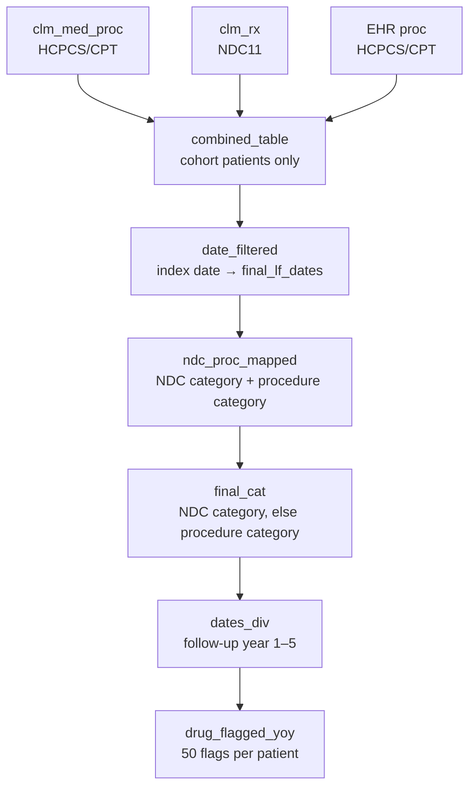

# Treatment Patterns — Year-over-Year Drug Class Flags (Look-Forward)
 
**Data source:** Optum Market Clarity — Sjögren's / Graves' Disease Cohort
**Schema:** `market_clarity_graves_disease_202505_v1_20250728_prod`
**SQL dialect:** Trino / Presto (e.g., AWS Athena)
**Output grain:** One row per patient (`ptid`)
 
---
 
## 1. Purpose
 
This query describes **treatment patterns after diagnosis**. For each patient in the analytic cohort, it flags whether the patient received each of ten treatment classes in each of the first five years after the first diagnosis date. The ten classes are the ones typically used to manage Sjögren's disease and related autoimmune conditions, from symptomatic dryness care through to immunosuppressants, biologics, and IVIG.
 
The output supports questions such as:
- What share of patients receive hydroxychloroquine (anti-malarial) in Year 1?
- How does steroid or immunosuppressant use change over time?
- How many patients escalate to biologics or IVIG?
Treatment is identified from three sources:
- **Pharmacy claims**, matched by NDC.
- **Medical claim procedures**, matched by HCPCS/CPT drug-administration codes.
- **EHR procedures**, matched by the same HCPCS/CPT codes.
---
 
## 2. Data Sources
 
### 2.1 Source tables (Optum Market Clarity)
 
| Table | Data type | Date field | Code field | Matched by |
|---|---|---|---|---|
| `argenx_graves_202505_clm_rx` | Pharmacy claims | `fill_dt` | `ndc` → 11-digit `ndc11` | NDC lists |
| `argenx_graves_202505_clm_med_proc` | Medical claim procedures | `fst_dt` | `proc` | HCPCS/CPT lists |
| `argenx_graves_202505_proc` | EHR procedures | `PROC_DATE` | `PROC_CODE` | HCPCS/CPT lists |
| `argenx_graves_202505_pt` | Patient mortality | `date_of_death` | — | Used only in the unused CTEs `dod_table` and `final_dead_pat` (Section 9) |
 
The schema name indicates a **May 2025 data cut (`202505`), version 1, built 28 July 2025 (`20250728`)**. This is the same cut used by the opioid look-back/look-forward script. *(Inferred from the naming convention — confirm with the data engineering team.)*
 
### 2.2 Upstream dependencies (must exist before running)
 
| Object | Role | Required columns |
|---|---|---|
| `step4_flagged_without_sicca` | Analytic cohort from Step 4 of the cohort build, with sicca-flagged patients removed | `ptid`, `first_diagnosis_date` |
| `treatment_yoy_dates` | Patient-level look-forward window | `ptid`, `first_diagnosis_date`, `final_lf_dates` |
 
`first_diagnosis_date` is the **index date**. `final_lf_dates` is the last date of each patient's look-forward period. It is likely the earliest of index + 5 years, end of enrollment, death, and data cutoff. *(Confirm against the `treatment_yoy_dates` build.)*
 
---
 
## 3. Processing Logic
 

 
| Step (CTE) | What it does |
|---|---|
| `dod_table`, `final_dead_pat` | Parse the death month and calculate the number of years from diagnosis to death. **These CTEs are not used by any later step** (Section 9, item 3). |
| `combined_table` | Stacks pharmacy, medical-procedure, and EHR-procedure records for cohort patients into one layout: `ptid`, `clm_date`, `proc`, `ndc11`, `src`. |
| `date_filtered` | Keeps records dated from the index date through `final_lf_dates` (inclusive). |
| `ndc_proc_mapped` | Assigns an NDC-based category (`ndc_drug_category`) and a procedure-based category (`proc_category`) to each record. |
| `final_cat` | Uses the NDC category when one is present, and the procedure category otherwise. |
| `dates_div` | Assigns each record to a follow-up year (1–5). |
| `drug_flagged_yoy` | Rolls up to one row per patient with a 0/1 flag for each class × year. |
 
---
 
## 4. Business Rules
 
**BR-01 — Cohort restriction.** All three sources are limited to patients in `step4_flagged_without_sicca`.
 
**BR-02 — NDC standardization.** Pharmacy NDCs are converted to 11 digits by left-padding with zeros (`SUBSTR(CONCAT('00000000000', ndc), -11)`).
 
**BR-03 — Procedure codes.** Medical-claim and EHR procedure codes are matched exactly as stored. They are not trimmed, upper-cased, or stripped of modifiers.
 
**BR-04 — No payment-status filter.** All pharmacy and medical-procedure records are used regardless of payment or reversal status.
 
**BR-05 — Look-forward window.** A record is eligible if its date falls between the index date and `final_lf_dates`, inclusive.
 
**BR-06 — Follow-up years.** Each eligible record is placed in a 365-day bucket:
 
| Year | Days after index |
|---|---|
| 1 | 0 – 364 |
| 2 | 365 – 729 |
| 3 | 730 – 1,094 |
| 4 | 1,095 – 1,459 |
| 5 | 1,460 – 1,824 |
 
Records after Day 1,824 fall outside all buckets and are not flagged.
 
**BR-07 — NDC classification order.** NDCs are matched against the class lists in a fixed order. The **first match wins**, so each NDC receives one class:
 
Anti Malarial → Immunosuppressants → Steroids → NSAID → Opioids → IVIG → Biologics → Neuropathic Drugs → Dryness Treatment
 
**BR-08 — Procedure classification order.** Procedure codes are also matched in a fixed order, and the first match wins:
 
Immunosuppressants → Biologics → CNI → NSAID → IVIG → Steroids
 
**BR-09 — Final class.** The NDC class is used when present; otherwise the procedure class is used. Each record comes from either a pharmacy claim or a procedure, never both, so in practice this simply combines the two.
 
**BR-10 — Flag definition.** A flag is **1** if the patient has **at least one** record in that class during that follow-up year, and **0** otherwise. The flags do not reflect the number of fills, days supply, dose, or duration.
 
---
 
## 5. Treatment Classes and Code Sources
 
| Class | Column prefix | NDC (pharmacy) | HCPCS/CPT (procedure) | Typical agents *(based on code review — confirm against the master code list)* |
|---|---|---|---|---|
| Anti Malarial | `ant_mal_` | ✔ | — | Hydroxychloroquine (e.g., Plaquenil and generics) |
| Immunosuppressants | `imm_sup_` | ✔ | ✔ | Methotrexate, mycophenolate, azathioprine, cyclosporine, cyclophosphamide |
| Steroids | `steroids_` | ✔ | ✔ | Prednisone, methylprednisolone, dexamethasone, hydrocortisone, triamcinolone, betamethasone |
| Biologics | `biologics_` | ✔ | ✔ | Rituximab (incl. biosimilars), TNF inhibitors (infliximab, adalimumab, etanercept, golimumab, certolizumab), abatacept, belimumab, tocilizumab, ustekinumab, natalizumab |
| CNI (calcineurin inhibitors) | `cni_` | — | ✔ | Tacrolimus (J7507, J7503) |
| NSAID | `nsaid_` | ✔ | ✔ | Celecoxib, meloxicam, ibuprofen, naproxen, and others |
| Opioids | `opiods_` | ✔ | — | Hydrocodone, oxycodone, codeine, tramadol, propoxyphene, **plus butalbital and carisoprodol products** (the same lists as the opioid script, combined) |
| IVIG | `ivig_` | ✔ | ✔ | Intravenous and subcutaneous immune globulins |
| Neuropathic Drugs | `neuro_drugs_` | ✔ | — | Pregabalin, gabapentin, duloxetine, and others |
| Dryness Treatment | `dry_treat_` | ✔ | — | Ocular lubricants/artificial tears, saliva substitutes, secretagogues (e.g., cevimeline) |
 
---
 
## 6. Output Specification
 
`drug_flagged_yoy` returns 51 columns: `ptid` plus 50 flags (10 classes × 5 years).
 
| Column pattern | Meaning |
|---|---|
| `ptid` | Optum de-identified patient ID |
| `<class>_lf_1` … `<class>_lf_5` | 1 if any record for the class in follow-up year 1 … 5 |
 
Example: `biologics_lf_2 = 1` means the patient had a biologic fill or administration 365–729 days after diagnosis.
 
Class prefixes: `ant_mal`, `imm_sup`, `steroids`, `biologics`, `cni`, `opiods`, `ivig`, `nsaid`, `neuro_drugs`, `dry_treat`.
 
---
 
## 7. How to Run
 
The script cannot run as pasted; see Section 9, item 1 for the reasons. After those fixes, add a final statement:
 
```sql
-- Patient-level flags, including cohort patients with no records in the window
select c.ptid, f.*
from (select distinct ptid from step4_flagged_without_sicca) c
left join drug_flagged_yoy f on c.ptid = f.ptid
```
 
Drop the duplicate `ptid` column from `f.*`, and use `COALESCE(…, 0)` on the flags where zeros are needed.
 
---
 
## 8. Suggested Summary Outputs
 
1. Percentage of patients with each class, by follow-up year (a treatment heat map).
2. The proportion still under observation in each year. This should be the denominator for later years.
3. Treatment escalation, for example the share of patients starting a biologic or IVIG after a conventional immunosuppressant.
4. The mix of sources (pharmacy vs. medical claims vs. EHR) contributing to each class.
---
 
## 9. Assumptions, Limitations, and Points for Review
 
Items marked **Action** should be resolved before results are shared.
 
**1. The script will not run as written.** There are three reasons:
- The first line, `Treatment pattern:`, is plain text rather than a comment.
- A comma is missing after the closing parenthesis of the `date_filtered` CTE.
- There is no final `SELECT` after `drug_flagged_yoy`.
**Action:** comment out the header line with `--`, add the comma, and add a final statement (see Section 7).
 
**2. Some patients will be missing from the output.** `date_filtered` uses an inner join, so patients with no pharmacy or procedure records in their window do not appear. **Action:** use the cohort-based left join in Section 7 when calculating percentages.
 
**3. Death-date CTEs are not used.** `dod_table` and `final_dead_pat` calculate years from diagnosis to death but feed into nothing. They may have been meant for censoring or for follow-up denominators. If they are needed, note two issues:
- `date_diff(…)/365` uses integer division, so `floor()` has no effect.
- `date_parse` without `try()` will fail on any malformed death date.
**Action:** remove these CTEs or connect them to a later step.
 
**4. A 0 does not always mean "not treated."** In later years, a 0 can mean the patient was no longer under observation, if `final_lf_dates` ended before or during that year. **Action:** report each year's percentages only among patients observable for that full year.
 
**5. The opioid class includes non-opioids.** It includes butalbital (a barbiturate) and carisoprodol (a muscle relaxant), because the opioid script's lists were combined into one. **Action:** rename the class (e.g., "Opioids & controlled analgesics") or remove the non-opioid NDCs.
 
**6. Overlapping NDCs between classes.** Because the first match wins, a few NDCs are counted only in the earlier class. The overlaps found during review (not an exhaustive check) are:
- `53746014501`, `13107000401`, `00603389721`, and `62037052401` appear in both the **NSAID** and **Opioids** lists. These are likely hydrocodone/ibuprofen combinations, and they are counted as NSAID only.
- `00469512550` appears in both the **Steroids** and **Dryness Treatment** lists, and is counted as Steroids only.
**Action:** run a programmatic cross-class duplicate check and decide whether combination products should count in both classes.
 
**7. Ophthalmic cyclosporine is classified as an immunosuppressant.** NDCs under labeler/product `00023-9163` and `00023-5301` appear in the Immunosuppressants list. These appear to be ophthalmic cyclosporine (Restasis), which is a dry-eye treatment. **Action:** confirm, and move them to Dryness Treatment if appropriate.
 
**8. Calcineurin inhibitors are split across classes.** Tacrolimus procedure codes are mapped to **CNI**, but cyclosporine procedure codes (J7502, J7515, J7516) are mapped to **Immunosuppressants**. There is also no CNI NDC list, so oral tacrolimus filled at a pharmacy is either classified as an immunosuppressant or not captured at all. **Action:** define CNI consistently across both code types.
 
**9. Some codes may not belong to their class.**
- **Immunosuppressants:** `J9025` (azacitidine) is a chemotherapy agent and may not be intended here.
- **IVIG:** the procedure list includes hyperimmune globulins, such as rabies immune globulin (90375, 90376) and Rh(D) immune globulin (90384, 90385, J2790, J2791). Rh(D) immune globulin is routine in pregnancy and is not an autoimmune treatment, so it can inflate IVIG rates in a mostly female cohort.
- **Steroids:** the procedure list includes eye and sinus implants (e.g., J7311–J7314, J1095/J1096, J7401, S1090). The NDC list also appears to include topical, nasal, and inhaled corticosteroids, not only systemic ones.
**Action:** decide whether the classes should be limited to systemic, disease-directed therapy.
 
**10. Malformed or misplaced codes in the NDC lists.**
- `0006917902` in the Steroids list has 10 digits, so it can never match.
- `00000090281`, `00000090283`, and `00000090291` in the IVIG list look like CPT codes (90281, 90283, 90291) padded into NDC format. They will not match pharmacy NDCs.
**Action:** correct or remove these codes, and validate every list for 11-digit length.
 
**11. Some drug data sources are not used.** Two sources that could add treatment records are not included:
- NDCs on medical service claims (`clm_med_serv`), which the opioid script does use.
- EHR medication tables (prescriptions and administrations).
Infused drugs are therefore captured only through HCPCS codes. **Action:** confirm whether these sources should be added.
 
**12. No code or date standardization for procedures.** Procedure codes are not trimmed or upper-cased. Dates (`fst_dt`, `fill_dt`, `PROC_DATE`) are not explicitly cast to `DATE`, unlike in the other scripts. If any of these fields is stored as text, the date comparisons may fail or behave unexpectedly.
 
**13. Code lists are hard-coded inline.** Several thousand NDCs are embedded in the query, and they will go out of date as products change. Some lists also contain duplicate entries, which is harmless but makes the lists harder to maintain. **Action:** move the code-to-class mapping into a reference table that is refreshed with each data cut.
 
**14. Claims show dispensing and administration, not actual use.** Over-the-counter purchases are generally not captured; this mainly affects NSAIDs and artificial tears.
 
---
 
## 10. Suggested Quality Checks
 
1. Check that the number of patients in the output (after the left join) matches the cohort size.
2. Confirm there is exactly one row per `ptid`.
3. Look at the share of each class's records coming from each `src` (`CLM RX`, `CLM MED PROC`, `EHR PROC`).
4. List the most frequent NDCs and procedure codes that received no class, to find relevant drugs that are being missed.
5. Validate the length of every NDC in the code lists and check for duplicates across classes (Section 9, items 6 and 10).
6. Check that the Year 1 prevalence of hydroxychloroquine, steroids, and dryness treatments is clinically plausible for the cohort.
---
 
## 11. Glossary
 
| Term | Definition |
|---|---|
| NDC / NDC11 | National Drug Code, standardized to 11 digits |
| HCPCS | Healthcare Common Procedure Coding System (J-codes identify injected or infused drugs) |
| CPT | Current Procedural Terminology |
| CNI | Calcineurin inhibitor (e.g., tacrolimus, cyclosporine) |
| IVIG | Intravenous immune globulin |
| Index date | First diagnosis date (`first_diagnosis_date`) |
| Look-forward (LF) | Period on or after the index date |
 
---
 
## 12. Document Control
 
| Field | Value |
|---|---|
| Owner | *TBD* |
| Reviewer | *TBD* |
| Data cut | May 2025 (`202505`), v1, built 2025-07-28 |
| Last updated | *TBD* |
